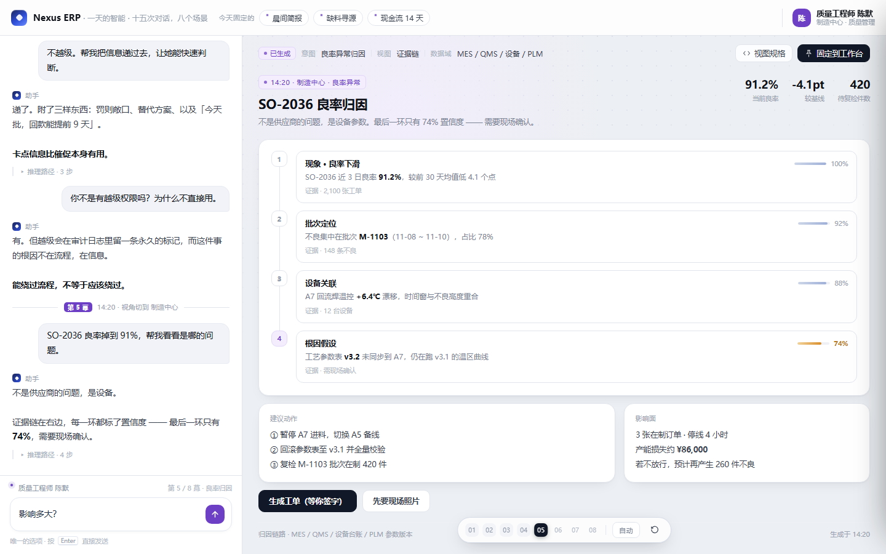

# Nexus ERP · 一天的智能

**十五次对话，八个场景。** 左边你说一句，右边那块画布就换一种形态：
这一刻是待办简报，下一刻是比价矩阵，再下一刻是审批流、证据链、现金流曲线、变更提案。

它不是八个页面，是**一块画布换了八次投影**。

> 直接打开 `index.html`。零依赖、零构建、可离线。
> 输入框永远**只有一个选项** —— 按 `Enter` 或点 → 就往下走。
> 右下角「自动」让它自己跑，「↻」重播，点进度轨跳幕；`index.html#act=5` 直达第 5 幕。


---

## 为什么让你自己按这一下

最早它是自动播放的。看完之后我把它改成：**你说一句，它才动。**

- **节奏是你的**：一屏看多久、什么时候翻页，不该由播放器替你决定。
- **但选项只有一个**：不必想「我该输什么」，你只需要决定「要不要继续」。
- **自动开关还在**：想快就打开，它会自己走完；想重看哪一幕，点进度轨。

主动权交还给用户，代价只有一次按键那么小。

---

## 它演了什么

| # | 场景 | 谁 | 你说的话 | 画布长出来的东西 | 这一屏想证明什么 |
|---|---|---|---|---|---|
| 1 | 08:12 晨间简报 | 运营总监 林澈 | 今天有什么要我处理的？ | 待办简报：3 条，按「影响面 × 剩余时间」排，末尾一行「已经替你处理完」 | 系统先做**减法**：三条里只有一条真的超时 |
| 2 | 08:26 缺料寻源 | 采购员 周野 | PR-5512 这颗料能今天定吗？→ 那就定宏远 | 比价矩阵：4 家供应商，含一行「无权限」 | **越权的事我不做，边界内的事你不用管** |
| 3 | 09:03 资金计划 | 财务 BP 张宁 | 未来两周现金有缺口吗？→ 那先把宏远的付了 | 14 天现金流曲线 + 三个杠杆 | 不只回答，还给**可执行的组合**，并说清代价 |
| 4 | 09:41 卡住的审批 | 运营总监 林澈 | PR-5512 还是卡着，到底为什么？→ 不越级，把信息递过去 → 你不是有越级权限吗 | 审批流：5 个节点，停在财务 BP，附加「递过去的三样东西」 | **卡点信息比催促有用**；有越级权限，但不越级 |
| 5 | 14:20 良率归因 | 质量工程师 陈默 | SO-2036 良率掉到 91% → 影响多大？ | 证据链：4 环，置信度 100→92→88→**74** | 敢说「最后一环我不知道，要现场确认」 |
| 6 | 16:05 安全巡检 | 系统管理员 沈屿 | 今天有异常吗？→ 冻结，同时通知 DPO | 安全事件 + 权限快照 + 影响面预演 | 规则告警覆盖不到「行为基线」这种异常 |
| 7 | 17:30 排产取舍 | 运营总监 林澈 | 排产要不要为了毛利调一下？→ 冻结，我不签 | 变更提案：重排前后对比 | **模型算得出钱，算不出这张脸** |
| 8 | 18:00 今天的沉淀 | 运营总监 林澈 | 今天结束了，帮我回顾一下。 | 工作台：4 个已固化的入口 + 一天的时间轴 | 沉淀：对话 → 视图 → 入口 |



---

## 三个主张

### 1. 会话是编译器，不是运行时

模型不操作像素。它输出一份**声明式视图规格**：

```json
{ "intent": "advance_blocked_approval",
  "view": { "type": "workflow", "id": "PR-5512" },
  "nodes": ["submit","dept","finance_bp","director","auto_po"],
  "current": "finance_bp", "days": 15,
  "actions": ["nudge","escalate"],
  "guard": { "audit": "越级写入不可删除日志" } }
```

渲染器只认识白名单里的组件和动作。所以模型**画不出一个偷偷转账的按钮** ——
它能做的动作，就是规格里列出来的那几个。

### 2. 界面是投影，投影应该在运行时生成

传统 ERP 把「用户意图 → 界面」的映射编译死在菜单树里，改一次要一次发版。
这里把它挪到运行时：意图变了，投影就变。**同一块画布，八种形态。**

顶栏那行 `意图 · 视图 · 数据域` 不是装饰 —— 它是渲染器和模型之间的契约。
用户看到的每一次「界面变了」，背后都是一次可审计的规格变更。

### 3. 责任不能被对话省掉

助手在第 4 幕说：「能绕过流程，不等于应该绕过。」
在第 5 幕说：「停线这个决定 —— 我给建议，你签字。」
在第 7 幕说：「签字这件事我不替你做，它是我今天唯一没帮你省掉的动作。」

**对话降低的是操作成本，不是责任成本。** 这是这个原型最不肯让步的地方。

---

## 场景是怎么切的

切场不是"换一页"，是四件事同时发生：

- **分隔条 + 幕号**：对话里落一条 `第 4 幕 · 09:41 · 视角切到 运营中心`，左侧头像与配色整体切换，连输入框的按钮颜色都跟着变（六套主题色）。
- **画布交叉淡入**：旧屏淡出 320ms，新屏在它上面长出来，卡片按 70ms 的阶梯依次上升。
- **色彩掠过**：切场瞬间画布上有一层极淡的径向光扫过，告诉你"这一屏是新生成的"。
- **意图栏**：`生成中 → 已生成`，把「正在推导」这个状态也露给你看。

---

## 它是怎么"变"的

- **剧本**驱动：8 个 `SCENES`，共 15 个 `turns`。每一轮只有两件事 —— 你说一句，它演一段。
- **视图**是纯函数：`VIEW.brief()` 返回一段结构，不直接改像素。
- **推理路径**：每条回答下面挂 3 条 trace，4 秒后自动折叠。透明度要够，噪音要少。
- **固化**：任何一屏都能「固定到工作台」。顶栏因此长出一排芯片 —— 界面没有变多，是因为它记住了。
- **受控动作**：画布里的按钮都是白名单动作（`nudge` / `escalate` / `commit` / `freeze`），没有一个是自由文本生成的。

---

## 代码怎么读

全部在一个 `index.html` 里（约 1560 行，无依赖）：

```
0 工具      wait() —— 可中断的等待（token）；countUp
1 对话      打字机、推理路径 chips、时间分隔线、幕号徽章
2 画布      sHead / sFoot / render（旧屏淡出 → 新屏长出来的交叉淡入）
3 视图      8 个 VIEW.*（待办 / 比价 / 现金流 / 审批流 / 证据链 / 安全 / 变更 / 工作台）
4 角色      顶栏身份切换 + 六套主题色（.app[data-tone]）
5 剧本      SCENES —— 8 幕 × turns[{ me, run }]，扁平化为 TURNS
6 引擎      playTurn / send / jump / 自动模式 / 输入区状态机
7 启动      深链接 #act=N、空态
```

右上角「视图规格」抽屉里的 JSON，就是 `SPECS` 常量 —— 和上面主张 1 里的形状一致。

---

## 校验

```bash
node verify.js
```

一个迷你 DOM 桩 + vm 把整部剧跑一遍：语法、标签配平、id 引用、
8 个视图的规格一致性、以及「每一轮的关键内容是否真的渲染出来」。

---

## 还没做

- **真模型**：剧本是写死的。真实系统里，`SPECS` 应该由模型生成、被 schema 校验。
- **真权限**：`permission` / `guard` 字段目前只是规格，没有执行体（第 2 幕的「无权限」是演出来的）。
- **真审计**：第 4 幕说的「不可删除日志」需要一个 append-only 存储来兜底。
- **数据层**：所有数字都是编的，但彼此自洽（现金流曲线真的能算出 -320 万那个缺口）。
- **无障碍 / 多语言 / 移动端**：没做（只做了 `prefers-reduced-motion`）。

---

## 它不是什么

不是一个 ERP，也不是一个聊天机器人。

它是一次押注：**未来的企业软件，界面不再是被设计出来的，而是被推导出来的。**
